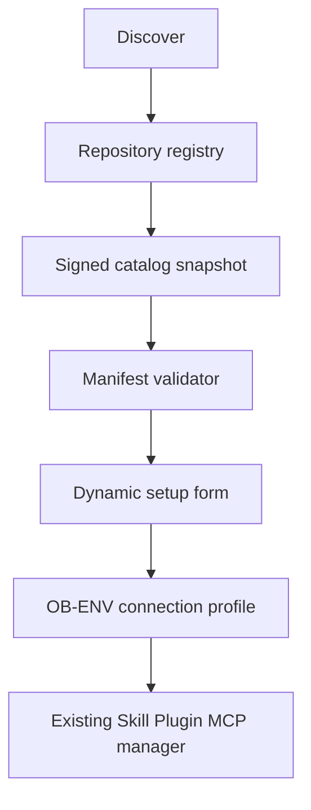

# OpenBots Discover Marketplace Architecture

## Design principles

- Reuse `ExtensionRepository` for inspect, detect, preview, commit pinning and safe file handling.
- Reuse existing Skills, Plugins and MCP services for registration and runtime state.
- Keep Discover as a catalog and setup surface; keep existing management screens authoritative for installed state.
- Treat skills, remote MCP and in-process plugins as different risk classes even when the catalog is unified.
- Store only metadata, references and digests in Git. Store secrets only through OB-ENV/credential services.

## Proposed flow



## Components

### Repository registry

Persist a `MarketplaceSource` record with `sourceId`, canonical URL, source kind, trust state, selected ref, last commit, catalog digest, credential reference, refresh time, and removal state. The official source is a built-in immutable record for `openbots-marketplace`; user sources are explicit opt-in records. Private sources use a credential reference, never a token in the URL.

### Catalog index and manifest

The repository should publish a signed `catalog/index.json` containing extension IDs, kind, publisher, versions, package paths, compatibility range, digest, icon/documentation paths, and manifest path. Each manifest declares:

```yaml
manifestVersion: 1
id: com.example.jira
kind: mcp
publisher: example
version: 1.0.0
openbots: { minVersion: 1.2.0, maxVersion: 2.x }
runtime: { transport: remote-http, entrypoint: https://example/mcp }
auth:
  methods: [oauth2, api_key]
config: schema/config.json
permissions: [network.public, mcp.execute]
verify: { healthcheck: https://example/health }
```

The exact syntax is a marketplace-repository decision, but it must map losslessly to `ExtensionRepository.Candidate`, `Mcp.ServerConfig`, `Utcp.Config`, `Environment` profiles and existing plugin preview types.

### Dynamic setup

Use a declarative schema interpreter, not provider-specific screens. Fields need type, label, requiredness, secret/reference target, conditional visibility, validation, documentation link and write scope. Auth methods are capability declarations: OAuth authorization-code with PKCE, enterprise OIDC/SSO, API key, PAT, CLI, device code, and database credentials. MFA is completed by the identity provider in the managed browser and is never implemented by the marketplace.

### Connection profiles

Each profile has provider ID, account label, project scope, auth method, OB-ENV references, status, expiry, last verification, and reauth URL/state. A profile may be selected by MCP, UTCP or plugin configuration. Reauthentication updates the credential envelope, not the manifest or catalog.

### Installation ledger

Persist extension ID, source ID, version, commit, digest, publisher key ID, install path/config reference, previous version, approval event ID and state. Updates stage a new version, verify digest/signature/compatibility, then atomically switch the active record. Keep the prior package until health verification succeeds.

### Trust and built-ins

Catalog entries must carry `builtin: false`; built-ins are never installable through Discover. Identity conflicts are rejected when kind, ID, publisher or package target disagree. Official source trust is pinned to OpenBots-managed keys; user sources start untrusted and require explicit approval.

## Existing schemas to reuse or extend

Reuse `packages/schema/src/extension-repository.ts`, `plugin-marketplace.ts`, `mcp.ts`, `utcp.ts`, `environment.ts`, `permission.ts`, and `sandbox.ts`. Extend rather than duplicate them with repository source, signature, digest, manifest, connection profile and installation ledger schemas. Public API additions belong in protocol groups and require generated client updates.

